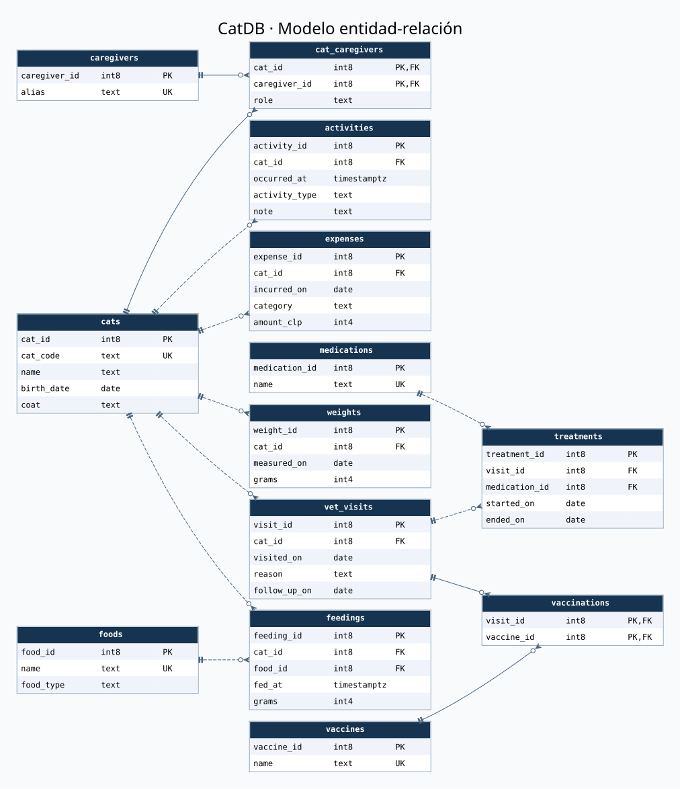

[English](README.md) | **Español**

# CatDB · CatHub

CatDB es una base de datos PostgreSQL 17 para explorar el historial de cuidado de gatos domésticos ficticios. Demuestra modelado relacional, carga reproducible de datos y SQL analítico en un proyecto breve para portafolios de desarrollo backend e ingeniería de datos.

## Objetivos y características

- Modelar responsables, mediciones, gastos, visitas y seguimientos en 13 tablas normalizadas.
- Usar restricciones, claves foráneas e índices para garantizar la integridad y facilitar las consultas.
- Reproducir una muestra ficticia y aprender con 10 consultas, ejercicios y resultados verificados.
- Ejecutar una demostración local persistente y una base de pruebas temporal e independiente.

## Tecnologías y arquitectura

PostgreSQL 17 se ejecuta en la imagen oficial para contenedores Linux. Bash y Podman administran la demostración en Fedora. PowerShell 7 y Docker Desktop proporcionan el flujo para Windows. Ambos puntos de entrada usan el mismo SQL y las mismas pruebas versionadas. DBeaver Community se conecta por loopback y un volumen nombrado almacena los datos. GitHub Actions ejecuta las comprobaciones automatizadas.

### Diagrama entidad-relación

[](docs/modelo.md#modelo-conceptual-lógico-y-diagrama-er)

La [guía del modelo](docs/modelo.md) contiene el código Mermaid que se compara con el catálogo de PostgreSQL y describe las tablas y sus relaciones.

## Requisitos e instalación

Necesitas conexión a internet para descargar por primera vez la imagen y el controlador JDBC de DBeaver. El puerto TCP `55432` debe estar libre para la instancia predeterminada. Instala el motor de contenedores de tu sistema operativo.

### Windows 11

1. En PowerShell, instala Git y PowerShell 7 con los comandos de abajo. Después abre una nueva ventana de PowerShell 7.
2. Instala y abre [Docker Desktop](https://docs.docker.com/desktop/setup/install/windows-install/). Habilita la virtualización de hardware si es necesario. Usa el motor WSL 2 predeterminado o selecciona Hyper-V si la edición de Windows y la instalación de Docker Desktop lo admiten. Ejecuta CatDB desde PowerShell 7 para Windows (`pwsh`).
3. Comprueba que Docker Desktop esté ejecutando contenedores Linux.

```powershell
winget install --exact --id Git.Git
winget install --exact --id Microsoft.PowerShell
# En una nueva ventana de PowerShell 7
docker info --format '{{.OSType}}'
git clone https://github.com/JonathanKaiKira/catdb-postgresql.git
cd catdb-postgresql
```

El comando de Docker debe mostrar `linux`. Si el instalador pide activar WSL 2, sigue sus indicaciones y reinicia Windows antes de ejecutar la demostración.

### Fedora/Linux

En Fedora, instala Git y Podman. En otras distribuciones de Linux, usa los paquetes de Git, Podman, Bash y `flock` (util-linux) de tu distribución. Ejecuta Podman con tu usuario habitual.

```bash
sudo dnf install git podman
podman info
git clone https://github.com/JonathanKaiKira/catdb-postgresql.git
cd catdb-postgresql
```

## Inicio rápido de cinco minutos

La primera descarga puede tardar más. Ejecuta estos comandos desde la raíz del repositorio.

| Operación | Windows PowerShell 7 | Fedora/Linux Bash |
| --- | --- | --- |
| Iniciar PostgreSQL y cargar la muestra | `.\scripts\demo.ps1 start` | `./scripts/demo.sh start` |
| Mostrar los parámetros de conexión | `.\scripts\demo.ps1 info` | `./scripts/demo.sh info` |
| Ejecutar todas las pruebas SQL | `.\scripts\demo.ps1 test` | `./scripts/demo.sh test` |
| Detener y conservar los datos | `.\scripts\demo.ps1 stop` | `./scripts/demo.sh stop` |

Cuando `start` muestre los parámetros, conéctate con DBeaver y ejecuta la consulta 01. Debe mostrar cuatro gatos. Continúa con el [recorrido completo](docs/aprendizaje/09-recorrido-demo.md).

## DBeaver y consultas de ejemplo

Instala [DBeaver Community](https://dbeaver.io/download/) con el instalador de Windows o el RPM de Fedora (`sudo dnf install ./<rpm-descargado>`, sustituyendo el marcador por el nombre del archivo). Abre **Database → New Database Connection → PostgreSQL** y completa estos campos.

| Campo | Valor predeterminado |
| --- | --- |
| Host | `127.0.0.1` |
| Puerto | `55432` |
| Base de datos | `catdb` |
| Usuario | `catdb_dev` |
| Contraseña | Valor de `POSTGRES_PASSWORD` en el archivo local que muestra `info` |

Selecciona **Test Connection**, descarga el controlador JDBC si se solicita y termina el asistente. En **Database Navigator**, expande la conexión → **Schemas → catdb → Tables** para ver las 13 tablas. Abre **ER Diagram** para ver sus relaciones. Abre [sql/04_demo.sql](sql/04_demo.sql) en el editor SQL, selecciona la conexión de CatDB y ejecuta cada una de las 10 sentencias con `Ctrl+Enter`. Luna tiene dos responsables, tres mediciones y 35.000 CLP de gastos. Pipa carece de historial y aparece en las uniones externas correspondientes. La [guía de DBeaver](docs/aprendizaje/05-guia-visual.md) y el [recorrido SQL](docs/aprendizaje/04-sql-explicado.md) explican los resultados.

## Pruebas, detención y datos

El comando `test` inicializa un contenedor PostgreSQL aislado y sin red. Valida el esquema, la integridad referencial, los datos ficticios, el resultado de 10 consultas y cinco soluciones, y la concordancia de Mermaid con el catálogo. En Fedora también puedes ejecutar `./scripts/verify.sh` directamente.

Desconecta DBeaver antes de ejecutar `stop`. El siguiente `start` reutiliza los datos y la credencial. Usa una instancia nueva para empezar con datos de práctica limpios y conservar la original.

```powershell
$env:CATDB_INSTANCE = 'catdb-practice'
$env:CATDB_PORT = '55433'
.\scripts\demo.ps1 start
# Al terminar
.\scripts\demo.ps1 stop
Remove-Item Env:CATDB_INSTANCE, Env:CATDB_PORT
```

```bash
CATDB_INSTANCE=catdb-practice CATDB_PORT=55433 ./scripts/demo.sh start
CATDB_INSTANCE=catdb-practice CATDB_PORT=55433 ./scripts/demo.sh stop
```

Consulta la [guía de operación](docs/operacion.md) para eliminar definitivamente un volumen de demostración. Conserva la credencial generada en el directorio `.catdb/`, que Git ignora.

## Solución de problemas

| Síntoma | Acción |
| --- | --- |
| El motor de contenedores no está disponible | Abre Docker Desktop y comprueba que use contenedores Linux, o ejecuta `podman info` en Fedora y atiende el error del motor. |
| El puerto está ocupado | Detén el servicio que lo usa o crea otra instancia con un `CATDB_PORT` libre. Conserva el mismo puerto en futuros arranques de esa instancia. |
| PowerShell bloquea la ejecución de scripts | Desde el clon de confianza, ejecuta `Set-ExecutionPolicy -Scope Process -ExecutionPolicy RemoteSigned` en PowerShell 7 y reintenta. Una política administrada puede requerir ayuda del administrador. |
| DBeaver rechaza la conexión | Ejecuta `start` y usa la dirección de loopback y el puerto que muestra `info`. |
| PostgreSQL rechaza la contraseña | Copia solo el valor que sigue a `POSTGRES_PASSWORD=`. Si falta el archivo de un volumen existente, recupéralo desde tu respaldo local. |
| DBeaver no muestra las tablas | Abre el esquema `catdb` de la base `catdb` y actualiza **Tables**. |

## Repositorio y guías

| Ruta | Contenido |
| --- | --- |
| [sql/](sql/) | Esquema, datos ficticios, validación y consultas de ejemplo |
| [scripts/](scripts/) | Demostración, lanzador de DBeaver y scripts de verificación |
| [tests/](tests/) | Pruebas de integridad y resultados esperados |
| [docs/](docs/) | [Requisitos](docs/requisitos.md), [modelo](docs/modelo.md), [arquitectura](docs/arquitectura.md), [operación](docs/operacion.md) y [validación](docs/validacion.md) |
| [docs/aprendizaje/](docs/aprendizaje/) | [Ejercicios](docs/aprendizaje/06-ejercicios.md), [soluciones](docs/aprendizaje/06-soluciones.md), [preguntas de entrevista](docs/aprendizaje/07-entrevista-tecnica.md) y [recorrido de demostración](docs/aprendizaje/09-recorrido-demo.md) |
| [.github/workflows/](.github/workflows/) | Comprobaciones de PostgreSQL y de plataforma |

Las guías detalladas de aprendizaje están en español. Las [notas de instalación y problemas frecuentes](docs/operacion.md) cubren ambos sistemas.

## Licencia y autor

[Licencia MIT](LICENSE) · Jonathan Curiñan · CatHub
