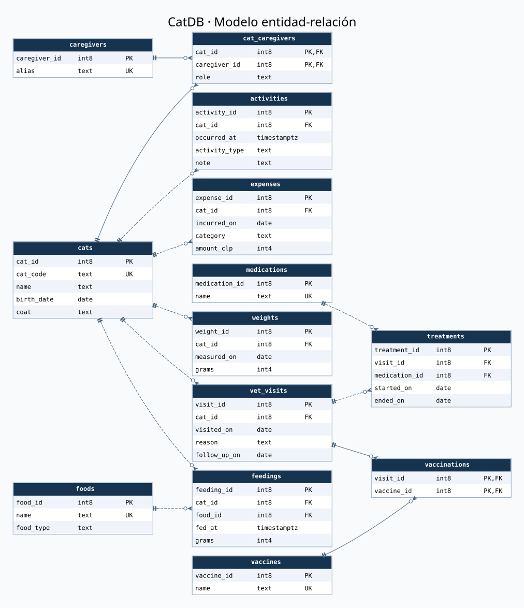

**English** | [Español](README.es.md)

# CatDB · CatHub

CatDB is a PostgreSQL 17 database for exploring the care history of fictional domestic cats. It demonstrates relational modeling, reproducible data loading, and analytical SQL in a small project for backend and data engineering portfolios.

## Objectives and features

- Model caregivers, measurements, expenses, visits, and follow-ups in 13 normalized tables.
- Use constraints, foreign keys, and indexes to enforce integrity and support queries.
- Reproduce a fictional dataset and learn through 10 queries, exercises, and verified results.
- Run a persistent local demo and a separate, disposable test database.

## Technology and architecture

PostgreSQL 17 runs in the official Linux container image. Bash and Podman manage the demo on Fedora. PowerShell 7 and Docker Desktop provide the Windows workflow. Both entry points use the same versioned SQL and tests. DBeaver Community connects over loopback, and a named volume stores the data. GitHub Actions runs the automated checks.

### Entity–relationship diagram

[](docs/modelo.md#modelo-conceptual-lógico-y-diagrama-er)

The [model guide](docs/modelo.md) contains the Mermaid source checked against the PostgreSQL catalog and describes the tables and relationships.

## Prerequisites and installation

Allow internet access for the first image pull and the DBeaver JDBC driver download. TCP port `55432` must be free for the default instance. Install the container engine for your operating system.

### Windows 11

1. In PowerShell, install Git and PowerShell 7 with the commands below. Open a fresh PowerShell 7 window afterwards.
2. Install and open [Docker Desktop](https://docs.docker.com/desktop/setup/install/windows-install/). Enable hardware virtualization if required. Use its default WSL 2 backend or select Hyper-V if your Windows edition and Docker Desktop installation support it. Run CatDB commands in PowerShell 7 on Windows (`pwsh`).
3. Confirm that Docker Desktop is running Linux containers.

```powershell
winget install --exact --id Git.Git
winget install --exact --id Microsoft.PowerShell
# In a new PowerShell 7 window
docker info --format '{{.OSType}}'
git clone https://github.com/JonathanKaiKira/catdb-postgresql.git
cd catdb-postgresql
```

The Docker command should print `linux`. If the installer requires WSL 2 to be enabled, follow its prompts and restart Windows before running the demo.

### Fedora/Linux

On Fedora, install Git and Podman. On other Linux distributions, use the distribution's packages for Git, Podman, Bash, and `flock` (util-linux). Run Podman as your regular user.

```bash
sudo dnf install git podman
podman info
git clone https://github.com/JonathanKaiKira/catdb-postgresql.git
cd catdb-postgresql
```

## Five-minute quick start

The first download may take longer. Run these commands from the repository root.

| Operation | Windows PowerShell 7 | Fedora/Linux Bash |
| --- | --- | --- |
| Start PostgreSQL and seed the schema | `.\scripts\demo.ps1 start` | `./scripts/demo.sh start` |
| Show connection details | `.\scripts\demo.ps1 info` | `./scripts/demo.sh info` |
| Run all SQL checks | `.\scripts\demo.ps1 test` | `./scripts/demo.sh test` |
| Stop and keep the data | `.\scripts\demo.ps1 stop` | `./scripts/demo.sh stop` |

Once `start` prints the connection details, connect with DBeaver and run query 01. It should list four cats. Use the [full walkthrough](docs/aprendizaje/09-recorrido-demo.md) to continue.

## DBeaver and example queries

Install [DBeaver Community](https://dbeaver.io/download/) with the Windows installer or the Fedora RPM (`sudo dnf install ./<downloaded-rpm>`, replacing the placeholder with the file name). Open **Database → New Database Connection → PostgreSQL** and enter:

| Field | Default |
| --- | --- |
| Host | `127.0.0.1` |
| Port | `55432` |
| Database | `catdb` |
| User | `catdb_dev` |
| Password | Value of `POSTGRES_PASSWORD` in the local file shown by `info` |

Select **Test Connection**, download the JDBC driver if prompted, and finish. In **Database Navigator**, expand the connection → **Schemas → catdb → Tables** to find all 13 tables. Open **ER Diagram** to view their relationships. Open [sql/04_demo.sql](sql/04_demo.sql) in the SQL editor, select the CatDB connection, and run each of its 10 statements with `Ctrl+Enter`. Luna has two caregivers, three measurements, and 35,000 CLP in expenses. Pipa has no history and still appears in the relevant outer joins. The [DBeaver guide](docs/aprendizaje/05-guia-visual.md) and [query walkthrough](docs/aprendizaje/04-sql-explicado.md) explain the results.

## Tests, stopping, and data

The `test` command initializes an isolated PostgreSQL container with networking disabled and validates the schema, referential integrity, sample data, 10 query outputs, five exercise solutions, and Mermaid agreement with the catalog. Fedora users can also run `./scripts/verify.sh` directly.

Disconnect DBeaver before running `stop`. The next `start` reuses the same data and credential. Use a fresh instance to reset your practice dataset while keeping the original.

```powershell
$env:CATDB_INSTANCE = 'catdb-practice'
$env:CATDB_PORT = '55433'
.\scripts\demo.ps1 start
# When finished
.\scripts\demo.ps1 stop
Remove-Item Env:CATDB_INSTANCE, Env:CATDB_PORT
```

```bash
CATDB_INSTANCE=catdb-practice CATDB_PORT=55433 ./scripts/demo.sh start
CATDB_INSTANCE=catdb-practice CATDB_PORT=55433 ./scripts/demo.sh stop
```

See the [operations guide](docs/operacion.md) to permanently remove a demo volume. Keep the generated credential in the Git-ignored `.catdb/` directory.

## Troubleshooting

| Symptom | Action |
| --- | --- |
| Container engine unavailable | Start Docker Desktop and confirm its Linux backend, or run `podman info` on Fedora and address the engine error. |
| Port already in use | Stop the service using it or use a fresh instance with an available `CATDB_PORT`. Keep the same port for later starts of that instance. |
| PowerShell says scripts are disabled | From the trusted clone, run `Set-ExecutionPolicy -Scope Process -ExecutionPolicy RemoteSigned` in PowerShell 7 and retry. Managed policies may require administrator support. |
| DBeaver refuses the connection | Run `start` and use the loopback address and actual port printed by `info`. |
| PostgreSQL rejects the password | Copy only the value after `POSTGRES_PASSWORD=`. If the file is missing for an existing volume, restore the original from your local backup. |
| Tables are missing in DBeaver | Open schema `catdb` in database `catdb`, then refresh **Tables**. |

## Repository and guides

| Path | Contents |
| --- | --- |
| [sql/](sql/) | Schema, fictional data, validation, and example queries |
| [scripts/](scripts/) | Demo, DBeaver launcher, and verification scripts |
| [tests/](tests/) | Integrity checks and expected output |
| [docs/](docs/) | [Requirements](docs/requisitos.md), [model](docs/modelo.md), [architecture](docs/arquitectura.md), [operations](docs/operacion.md), and [validation](docs/validacion.md) |
| [docs/aprendizaje/](docs/aprendizaje/) | [Exercises](docs/aprendizaje/06-ejercicios.md), [solutions](docs/aprendizaje/06-soluciones.md), [interview questions](docs/aprendizaje/07-entrevista-tecnica.md), and [demo walkthrough](docs/aprendizaje/09-recorrido-demo.md) |
| [.github/workflows/](.github/workflows/) | PostgreSQL and platform checks |

The detailed learning guides are written in Spanish. [Troubleshooting and installation notes](docs/operacion.md) cover both platforms.

## License and author

[MIT License](LICENSE) · Jonathan Curiñan · CatHub
