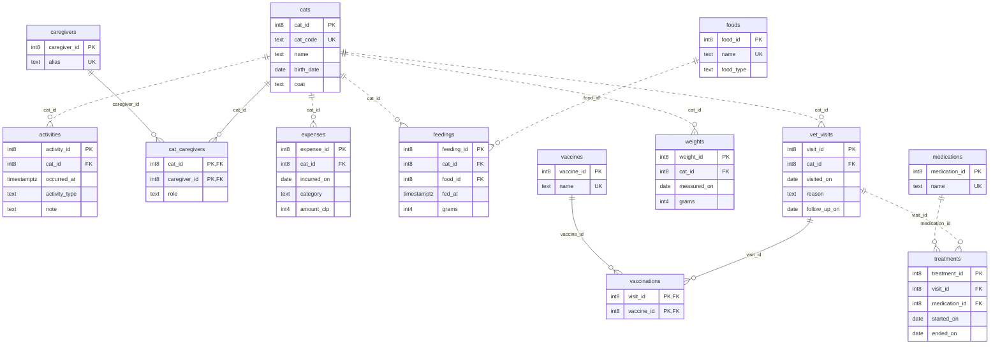

# Modelo conceptual, lógico y diagrama ER

En CatDB, el gato es el punto de partida para investigar alimentación, pesos, visitas, gastos y actividades. Una persona puede cuidar a varios gatos y cada gato puede tener varias personas vinculadas. Una visita puede registrar varias vacunas y tratamientos. La visita relaciona ambos hechos con el gato.

Cada FK tiene un padre obligatorio y cada padre admite cero o más filas hijas. Las líneas sólidas muestran relaciones identificadoras, donde la FK forma parte de la PK hija. Las líneas punteadas muestran relaciones con identidad propia. `UK` marca claves únicas de una sola columna. La restricción compuesta `UNIQUE (cat_id, measured_on)` de `weights` complementa las marcas del diagrama.

## Normalización hasta 3FN

1. **1FN.** Una fila registra un hecho y cada campo contiene un valor. Un catálogo de gatos no tiene listas de dueños, vacunas o pesos en una celda.
2. **2FN.** En `cat_caregivers`, el rol depende de la pareja completa `(cat_id, caregiver_id)`. En `vaccinations` la pareja identifica el hecho sin atributos adicionales. En `weights`, los gramos dependen de la pareja `(cat_id, measured_on)` y no de uno de sus componentes.
3. **3FN.** Las descripciones de alimentos, vacunas y medicamentos viven en sus catálogos. Un tratamiento guarda la visita y de ella se obtiene el gato, lo que evita la dependencia transitiva tratamiento → visita → gato. Los totales de gasto se calculan a partir de los hechos.

[Detalle de las 13 tablas](aprendizaje/03-modelo-relacional.md).
[Diagrama en SVG](diagrama.svg).
