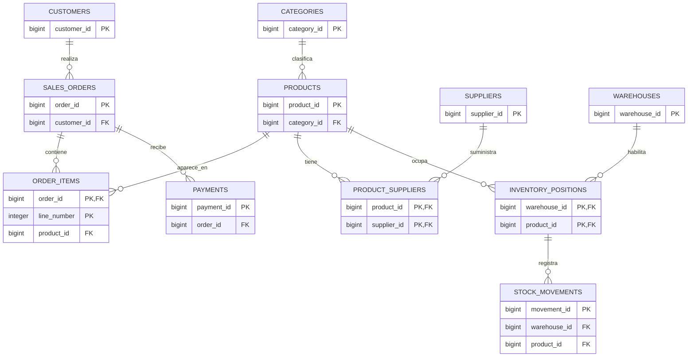

# Modelo de datos

## Modelo conceptual

Un cliente puede realizar varios pedidos. Cada pedido agrupa líneas y recibe pagos parciales. Cada línea corresponde a un producto y conserva el precio de la venta. Los productos pertenecen a una categoría y pueden tener varios proveedores. Una bodega habilita posiciones para productos y cada posición acumula movimientos de inventario.

## Modelo lógico

Las claves primarias se muestran en el diagrama. También son únicas las claves candidatas de negocio `customers.email`, `suppliers.supplier_code`, `categories.name`, `products.sku`, `warehouses.code` y `payments.reference`. Los campos utilizados en cada relación se detallan en el [DDL](../sql/01_schema.sql).

La relación entre movimientos y posiciones usa una sola clave foránea compuesta por `warehouse_id` y `product_id`.

## Normalización

1. **1FN.** Los valores son escalares. Las líneas de pedido, pagos y vínculos entre productos y proveedores residen en filas independientes.
2. **2FN.** En `order_items`, el producto, la cantidad y el precio pactado dependen de la combinación `(order_id, line_number)`. Las otras tablas de clave compuesta representan asociaciones y carecen de atributos no clave.
3. **3FN.** Los nombres de categoría, cliente y proveedor se almacenan en sus entidades. El precio de catálogo depende del producto. El precio pactado depende de la línea y preserva el historial cuando cambia el catálogo. Existencias y saldos se calculan en vistas a partir de movimientos, líneas y pagos.
